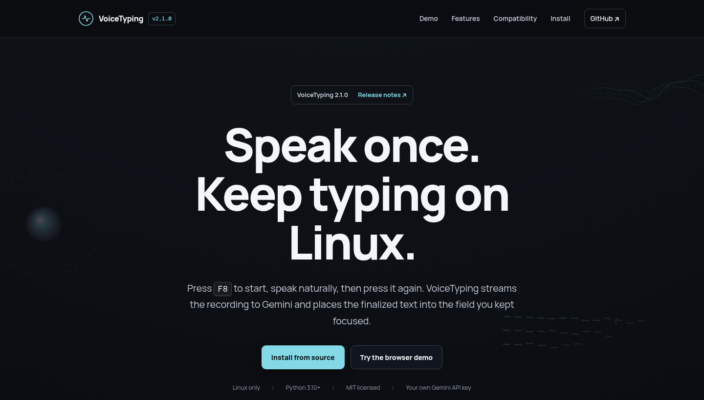

<div align="center">

# VoiceTyping

**Speak once. Keep typing on Linux.**

Press `F8`, speak, then press it again. VoiceTyping transcribes the recording
with Gemini and pastes the final text into the field you kept focused.

[Website](https://voicetyping1.vercel.app/) ·
[VoiceTyping 2.1.0](https://github.com/fadayat/voicetyping/releases/tag/v2.1.0) ·
[Changelog](CHANGELOG.md) ·
[MIT license](LICENSE)

</div>

[](https://voicetyping1.vercel.app/)

VoiceTyping is an open-source Linux desktop dictation utility. It streams audio
while you speak, keeps the complete recording in memory as a fallback, and
inserts only the finalized transcript.

## One shortcut, three steps

| Step | What VoiceTyping does |
| --- | --- |
| **1. Capture** | `F8` starts and stops a recording from the default microphone. |
| **2. Transcribe** | Gemini Live handles the active stream. The complete recording can use batch transcription if Live fails. |
| **3. Insert** | The final text is copied and pasted with `Ctrl+V`, or `Ctrl+Shift+V` in recognized standalone terminals. |

VoiceTyping never sends the Enter key. If automatic paste is unavailable, the
transcript remains on the clipboard.

## Install

You need Linux, Python 3.10 or newer, an internet connection, and your own
[Gemini API key](https://aistudio.google.com/).

<details>
<summary>Install the required system packages</summary>

### Fedora

```bash
sudo dnf install wl-clipboard xclip portaudio python3-tkinter \
  python3-gobject python3-cairo gtk3 libappindicator-gtk3 libayatana-appindicator-gtk3
```

### Debian and Ubuntu

```bash
sudo apt update
sudo apt install xclip wl-clipboard libportaudio2 python3-tk python3-gi \
  python3-gi-cairo gir1.2-gtk-3.0 libappindicator3-1
```

</details>

Clone the repository and run the installer as your regular user:

```bash
git clone https://github.com/fadayat/voicetyping.git
cd voicetyping
chmod +x install.sh
./install.sh
```

The installer places VoiceTyping under `~/.local/bin/voicetyping`, adds an
Applications menu entry and autostart entry, and configures the GNOME shortcut
when it can do so without replacing an existing shortcut.

## Use VoiceTyping

1. Launch **VoiceTyping** from the Applications menu.
2. Enter your Gemini API key on first run.
3. Focus a text field and press `F8`.
4. Speak, then press `F8` again. Keep the destination focused until the text is
   inserted.

The floating indicator grows with your voice, flows while the transcript is
finalized, and disappears when the text is ready. It stays click-through and
does not take keyboard focus.

## Compatibility

| Environment | Behavior |
| --- | --- |
| **GNOME Wayland** | Best supported. The installer can add the global `F8` shortcut, and automatic paste uses a temporary Mutter input session. |
| **Other Linux desktops** | Use the tray or in-app `F8` listener while VoiceTyping is running, or bind `voicetyping_toggle.py` as a desktop shortcut. |
| **Standalone terminals** | Recognized terminals receive `Ctrl+Shift+V`. Unknown or custom terminal setups may need manual paste. |
| **Editors and ordinary fields** | Receive the standard `Ctrl+V` shortcut. |

GNOME automatic paste relies on a private Mutter API, so a GNOME update can
change compatibility. The animation requires a composited desktop.

## Privacy and local data

- Audio is sent to Google only during a recording you start. A failed Live
  session may resend the complete in-memory recording through batch
  transcription.
- VoiceTyping does not keep an audio archive and does not log audio, transcript
  text, or API keys.
- The saved API key is plain text in
  `~/.config/voicetyping/config.json`, protected with owner-only permissions
  (`0600`). Anyone with access to your local account can read and use it.
- Configuration files, environment files, recordings, and logs should remain
  local. This repository includes no API key.

## Settings

The tray menu contains **Settings (API Key)**. You can also provide the key with
the `GEMINI_API_KEY` environment variable.

Add optional settings to the existing configuration JSON, then restart the app:

| Setting | Default | Purpose |
| --- | --- | --- |
| `"auto_paste": false` | `true` | Keep the transcript on the clipboard without sending a paste shortcut. |
| `"live_transcription": false` | `true` | Use the complete-recording batch path. |
| `"language_codes": []` | Azerbaijani hint | Let Gemini detect the spoken language automatically. |

<details>
<summary>Recording limits and failure behavior</summary>

- A recording can run for up to seven minutes.
- Recordings shorter than 0.25 seconds and recordings detected as silence are
  rejected before copy or batch fallback.
- VoiceTyping switches to batch transcription when Live is unavailable, the
  connection breaks, audio buffering overflows, or finalization exceeds three
  seconds. Partial Live text is never used as the final result.
- Failed Live attempts have a 60-second cooldown.
- Clipboard support needs `wl-clipboard` on Wayland or `xclip` on X11.
- Multiline text pasted into a terminal may execute commands according to that
  terminal and shell's own settings, even though VoiceTyping never presses
  Enter.

</details>

## Development

```bash
python3 -m pip install --user -r requirements.txt
python3 voicetyping.py
python3 -m unittest discover -s tests -v
```

The app uses Tkinter for API-key setup, GTK3/Cairo for the transparent
indicator, Google GenAI for transcription, and desktop-specific clipboard and
shortcut integrations. See [DESIGN.md](DESIGN.md) for the internal design.

## License

VoiceTyping is available under the [MIT License](LICENSE).
